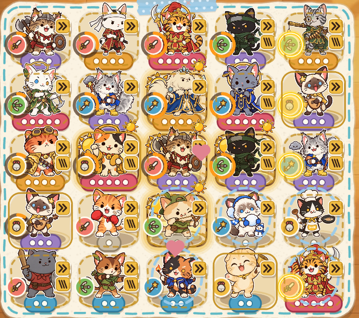

# 고유 스킬 설계안 v1 — 골목대장 이상 12마리와 SP 게이지

> **이 문서의 §3(열두 개의 스킬)과 §1의 요약 표는 사용자가 물렸고 [`design_skills_v2.md`](design_skills_v2.md)로 대체됐다.** §2(게이지 규칙)·§4~§7은 v2 §0에 적은 바뀐 곳(쿨타임 사다리, 복고양이 보너스 삭제, 5등급 도달 거리, 밀치기 창 3초)만 빼고 그대로 선다.

> 2026-10-12 · 묶음 5 항목 2 · **설계안만이다. 소스와 테스트는 하나도 바꾸지 않았다**(이 문서와 그림 한 장이 전부). 기준 커밋 `27301a1`.
> 원문(사용자): "골목대장 이상 캐릭터마다 각자의 스킬을 만드는 건 어떤가 싶은데. SP 게이지 같은 걸 넣어서 인게임에서 게이지가 차는 걸로 쿨타임을 표현하고 다 차면 스킬 쓰게 하고. (일단 바이킹냥은 적을 밀치는 류로 생각 중)"
> 숫자는 전부 **첫 추정**이다. 판단 근거로 쓴 봇 수치는 임시 폴더의 시제품에서 잰 것이고(부록 A), 저장소에는 시제품이 없다.
> 화면 그림 한 장(`docs/design_skills_v1_ring.png`)은 실제 5×5 보드(고양이 25마리)에 게이지 고리를 임시로 얹어 찍은 것이다(저장소의 소스는 건드리지 않고 브라우저 메모리에서만 그렸다).

## 0. 이름 주의

코드와 화면에는 이미 "스킬"이 있다. `unit.<id>.skill`, `skillText()`, `skillArgs`, 고양이 화면의 "특기" 쪽이 **고양이의 기본 공격 설명**(패시브)이다. 새 기능은

- 화면 한국어: **스킬**(사용자 표현), 게이지는 **SP**. 기존 "특기"는 그대로 기본 능력 줄로 남는다.
- 화면 영어: 새것은 **Skill**, 기존 "Skill"(`cats.unit.skill`)은 **Ability**로 바꾼다(문구 한 줄).
- 코드: `sp` 접두어로 겹침을 피한다. `data/spSkills.ts`, `sim/spSkills.ts`, `UnitState.sp`, 이벤트 `spSkill`, `BattleInit.sp`. (`tests/sim.skills.test.ts`는 기존 기본 능력 시험이라 이름이 겹친다. 새 시험은 `sim.spSkills.test.ts`.)

---

## 1. 한 장 요약 (사용자가 이것만 보고 정할 수 있게)

**무엇을 만드나.** 골목대장(3등급)·대왕(4)·수호신(5) 열두 마리가 각자 스킬 하나를 갖는다. 고양이 왼쪽 아래 직업 스티커를 **고리 게이지**(SP)가 감싸고, 시간이 지나면 차고, 가득 차면 노랗게 빛나다가 **저절로 발동**한다. 꼬마·동네 고양이는 스킬이 없다(봇의 판 후반 보드는 12마리 가운데 6~7마리가 고리를 단다).

**자동으로 발동시키는 이유(권장).** ① 25마리가 서는 보드에서 손으로 누를 일이 몇 초에 하나, 3배속에서는 거의 초당 하나꼴이 된다. ② 칸(108×96)을 누르면 이미 "선택"이고 끌면 "이동"이라 눌러서 쓰는 몸짓이 겹친다. ③ 봇·튜토리얼·결정성·이어하기가 거의 그대로다. 조종은 지금처럼 **레이저 하나**로 둔다. 레이저가 켜져 있으면 스킬도 레이저 점 안의 적, 그다음 정예·보스를 먼저 노린다(손이 닿는 유일한 조종).

**게이지.** 시간으로만 찬다(골목대장 20초, 대왕 16초, 수호신 12초). "공격하면 조금 더 빨리"는 뺐다. 잰 결과 +2%p(오차 안)라서 규칙 설명만 늘기 때문이다(조절 칸은 남긴다). 적이 없으면 가득 찬 채 기다렸다가 적이 닿는 틱에 쓴다(전사의 함성과 같은 규칙).

| 직업 | 고양이(등급) | 스킬 | 한 줄 | 게이지 |
|---|---|---|---|---|
| 전사 | 바이킹냥(골목대장) | **방패 밀치기** | 사거리 안의 적을 길 뒤로 1.5칸 밀어낸다 | 20초 |
| 전사 | 사무라이냥(대왕) | **한 칼에!** | 가장 앞선 적(정예·보스 우선)을 크게 베고, 피 흘리는 적을 마저 벤다 | 16초 |
| 전사 | 호랑이 장군(수호신) | **진짜 호랑이다!** | 4초 동안 공격 속도 +40%, 사거리 +10% | 12초 |
| 사수 | 닌자냥(골목대장) | **수리검 소나기** | 수리검 10개를 서로 다른 적에게 한꺼번에 | 20초 |
| 사수 | 총잡이냥(대왕) | **백발백중** | 다음 2발이 반드시 치명타 | 16초 |
| 사수 | 별빛 사수(수호신) | **별똥별 세례** | 3초 동안 공격 속도 +40% | 12초 |
| 마법사 | 번개냥(골목대장) | **번개 폭풍** | 번개 6줄기가 서로 다른 적에게 내리친다(감전 없음) | 20초 |
| 마법사 | 얼음 여왕(대왕) | **겨울의 숨결** | 사거리 안 모든 적을 치고, 얼거나 느려진 적은 2배 | 16초 |
| 마법사 | 우주냥(수호신) | **초신성** | 가장 많이 모인 곳에 큰 폭발(끌어당김 없음) | 12초 |
| 재주 | 악사냥(골목대장) | **앙코르!** | 주변 8칸 고양이 공격 속도 +25%(5초) | 20초 |
| 재주 | 연금술사냥(대왕) | **약점 폭로** | 필드의 모든 적이 4초 동안 받는 피해 +25% | 16초 |
| 재주 | 복고양이(수호신) | **복이 와요!** | 모든 고양이의 공격 게이지가 한꺼번에 가득 찬다 | 12초 |

**바이킹냥의 밀치기**는 적이 도는 닫힌 고리 위에서 "걸어온 쪽으로 150px 되돌림"이다(끌어당김과 같은 한 줄 `travelled -= d`). 일반 적은 전부, 정예는 ×0.35, 보스는 ×0.2만 밀리고, 밀린 적은 4초 동안 다시 밀리거나 끌리지 않는다. 블랙홀과 다른 점: 한 점으로 모으지 않고(간격 유지), 터뜨리지 않고, 순간이다(§3.2).

**세기.** 시제품(봇 150판, 챕터 1)으로 재면 열두 개를 합쳐 **집사 0~5단계 승률이 +0 ~ +15%p**(평균 +6~7%p, 오차 ±4%p)이고, 쉬운 단계(0~2)는 천장에 막혀 +0~5, 어려운 단계(3~5)는 +8~15로 더 크다. 식으로 세면 보드 화력이 1스테이지 +5%에서 6스테이지 +16%까지 오른다(§4). 같은 난이도를 지키려면 챕터 체력 배수를 약 **×1.15** 올려야 한다는 측정이 나왔다. 난이도는 사용자가 정하므로 숫자는 건드리지 않았다.

**비용.** 전체 약 2,200~2,800줄(시험 약 600줄 포함; 아래 끝은 §6의 단계 합계 600 + 900 + 500 + 200, 위 끝은 §5의 L·M 행을 더한 값이고, 측정 시간은 따로다). 4단계로 나누고, 1단계는 **전사 세 마리만**(약 600줄)이라서 한 번에 플레이해 볼 수 있다(§6).

**사용자가 정해 줄 것(권장 답 포함, 전체는 §7).**
1. 자동 발동으로 가도 되나? → **예**(나중에 "누르고 있으면 보관" 한 가지를 얹을지는 써 보고).
2. 12마리 전부 하나요, 대왕 이상 6마리부터요? → **12마리**(1단계는 전사 3마리).
3. 세진 만큼 어렵게 되돌릴까요? → **사용자 결정**(체력 ×1.15가 한 줄 처방).
4. 사수의 스킬 수치를 낮게 시작할까요? → **예**(사수가 이미 가장 세다).
5. 이름: "스킬"로 쓰고 기존 영어 "Skill"을 "Ability"로 바꿔도 되나? → **예**.

---

## 2. 게이지 규칙

### 2.1 무엇이 얼마나 빨리 채우나

| 요소 | 규칙 | 이유 |
|---|---|---|
| 시간 | 틱마다 `+= TICK / 쿨타임`. 쿨타임 **골목대장 20초, 대왕 16초, 수호신 12초**(데이터 한 칸씩, 스킬마다 따로 고칠 수 있다) | 한 웨이브가 15초다. 높은 등급일수록 빨리 차야 합성·각성이 스킬로도 보상받는다. 한 웨이브에 차는 횟수: 0.75 / 0.94 / 1.25 |
| 공격 | **v1에서는 없음**(조절 값 `SP_COMBAT_RATE = 1`) | 시제품에서 "사거리 안에 적이 있는 동안 ×1.3"을 재 보니 집사 3단계 승률 75% → 77%(오차 안), 직업별 차이 없음(사수 91 → 91). 효과는 작고, 눈에 안 보이는 가산이라 "왜 이 고양이만 느리지?"가 생긴다(전사는 사거리 안에 있는 시간이 짧다) |
| 복고양이 | 다른 스킬 고양이의 게이지에 +15%(자기 것은 제외) | 재주의 "도움이 느껴져야 한다" |
| 멈춤 | 위험 칸에 막힌 동안과 회복 0.3초(공격과 같다). 선택 창·일시정지·광고·튜토리얼 설명 중에는 시뮬레이션이 멈추므로 같이 선다 | 공격 게이지의 규칙을 그대로 쓴다(`blocked`) |
| 약화 | 드라이기·흡입의 "약화"(공격 간격 ×2)는 게이지에 닿지 않는다 | 약화는 공격 이야기고 스킬은 따로 흐른다 |

발동한 틱에 게이지는 0으로 돌아간다. 한 틱에 둘 이상이 가득 차면 **칸 번호 순서**로 쓴다(결정성).

### 2.2 상황별 규칙

| 상황 | 규칙 |
|---|---|
| **사거리 안에 적이 없을 때** | 게이지는 계속 차고 **가득 찬 채 기다린다**. 스킬에 쓸 대상이 생긴 그 틱에 발동한다(공격 게이지가 1에서 기다리는 것과, 전사의 함성이 "준비된 채 기다렸다가 적이 들어온 틱에 터진다"는 것과 같다). 사거리 기준 스킬(자기를 강하게 하는 호랑이·총잡이·별빛 사수도 포함: 적이 없을 때 버프를 낭비하지 않는다)은 그 고양이의 사거리 안에, 판 전체 스킬(약점 폭로·앙코르·복이 와요)은 필드에 적이 한 마리라도 있을 때. 가운데 칸의 전사처럼 영영 닿지 않는 고양이는 고리가 가득 찬 채 가만히 있다. 그것이 "이 고양이는 놀고 있다"는 공짜 신호다 |
| **웨이브 사이** | 일반 웨이브는 끊기지 않고 이어지므로 쉬는 틈이 없다. 게이지는 리셋도 보너스도 없이 흐른다. 스테이지 끝(보스 처치 1.2초 → 장난감 고르기 → 1초) 사이의 선택 창에서는 시뮬레이션이 멈추므로 게이지도 멈춘다 |
| **이어하기** | 이어하기 저장은 웨이브 시작 때 고양이의 id만 담는다. 게이지는 저장하지 않고 복구한 고양이는 **50%**에서 시작한다(공격 게이지의 0.5와 같다). `SIM_VERSION`은 3 그대로(§5) |
| **옮길 때** | 게이지를 **그대로 들고 간다**(이동·교환 모두, 공격 게이지와 같은 규칙: 명세 §5). 위험 칸에서 옮겨 나오면 0.3초 뒤부터 다시 찬다 |
| **합성할 때** | 두 마리가 사라지고 새 고양이는 **50%**에서 시작한다(`MERGE_START_CHARGE`와 같은 값, 한 줄로 설명된다: "합치면 반쯤 차서 나와요") |
| **털갈이·각성할 때** | 게이지 비율을 **이어받는다**(털갈이는 같은 등급의 다른 직업이라 스킬 고양이끼리, 각성은 대왕 → 수호신). 각성은 "그 고양이가 자라는" 장면이라, 쌓아 둔 게이지를 잃으면 손해로 읽힌다 |
| **팔 때** | 게이지는 사라진다. 환급은 그대로 |
| **같은 고양이가 여럿일 때** | 마리마다 게이지가 따로다. 효과는 겹침 규칙으로 막는다: 밀치기는 적마다 4초 창을 공유하고, 이웃에게 주는 버프(앙코르)는 "같은 종류는 가장 큰 값 하나만"(명세 §7), 약점 폭로는 취약의 "가장 큰 값 하나만", 복고양이의 게이지 보너스만 더해진다(상한 1) |
| **2배속·3배속** | 게이지는 시뮬레이션 시간이라 배속을 그대로 따라간다(고리가 2~3배 빨리 찬다). 연출은 실제 시간으로 흐르므로 3배속에서는 초당 발동이 3배다. §2.4의 한도와 병합 규칙이 막는다 |

### 2.3 화면에서 어떻게 보이나

**어디에.** 고양이 왼쪽 아래(발 높이)에 붙은 **직업 스티커**(지름 28)를 감싸는 고리다. 이유는 지금 칸에 빈자리가 없어서다. 발밑은 등급 띠가 칸 아래 끝까지 차지하고, 오른쪽 옆은 재주의 버프 배지 기둥(공속 »·피해 ///)과 특수 칸 배지가 쓴다. 고리는 새 칸을 쓰지 않고, 고리가 있다는 것만으로 "이 고양이는 스킬이 있다"가 읽힌다. 처음 구상(발밑 작은 막대)은 실제 25마리 보드에 얹어 보고 접었다: 막대는 등급 띠 위, 발 그림자 위에 얹혀 묻히고, 아래로 내리면 칸 밖으로 나간다. 아래 그림(`docs/design_skills_v1_ring.png`)이 제안한 고리의 모습이다. 보드에는 고양이 25마리가 서 있고 그중 17마리(열두 종 + 겹친 다섯 마리)가 스킬 고양이이며, 고리마다 일부러 다른 비율(10 · 30 · 55 · 80 · 100%)로 그렸다. 오른쪽 열의 노란 고리가 "가득 참"이다.



크기(제안): 고리 반지름 17, 선 굵기 4.5(설계 px). 스티커를 칸 안쪽으로 3px 옮기면 고리 바깥이 칸 왼쪽 가장자리(−54)에 딱 닿는다. 그림의 임시 고리는 반지름 18.5, 선 5로 그렸고(스티커는 그대로) 칸 가장자리를 약 3px 넘는다. 450×900과 360×800 화면에서 모두 확인했다(360에서도 "가득 참"은 한눈에 읽히고, "채우는 중"은 비율이 대강 읽힌다. 처음에 흰 호로 그렸더니 크림색 칸 위에서 묻혀서 어두운 트랙 + 주황 호로 바꿨다).

**세 순간.**

```
 [채우는 중]            [가득 참(대기)]         [방금 발동(0.3초)]
 +----------------+     +----------------+      +----------------+
 |      /\_/\   >>|     |      /\_/\   >>|      | *    /\_/\   >>|
 |     ( o.o )    |     |     ( o.o )    |      |     ( >.< )  ^ |
 | (◔) > ^ <      |     | (●) > ^ <      |      | (○) > ^ <  ~~  |
 |     /|_|\      |     |     /|_|\      |      |     /|_|\      |
 |    [ o o o ]   |     |    [ o o o ]   |      |    [ o o o ]   |
 +----------------+     +----------------+      +----------------+
   고리 = 어두운 트랙       고리가 닫힌 노란 원 +    고리가 흰 번쩍임 뒤
   + 주황 호(12시에서       안쪽 흰 선 + 은은한      0으로 비고, 고양이가
   시계 방향). 비율은       광원. 스티커가 0.5초     한 번 으쓱(크기
   4칸(◔ ◑ ◕ ●)쯤으로      주기로 살짝 커졌다       1.0 → 1.12 → 1.0,
   읽으면 충분하다          작아진다                  위로 4px) + 스킬 연출
```

- **가득 참은 색에만 기대지 않는다**(등급 띠에 칸 수 점을 박은 것과 같은 원칙): 호가 아니라 *닫힌 원* + 광원 + 움직임이다. 동작 줄이기에서는 움직임을 끄고 고리 위에 별 모양(✦) 점 하나를 정지한 채 남긴다.
- **이름 말풍선**은 한 판에 스킬마다 **처음 한 번만** 고양이 머리 위에 0.8초 띄운다("방패 밀치기!"). 매번 띄우면 소음이다.
- 스킬이 시간 효과(호랑이 4초, 별빛 사수 3초, 악사냥의 주변 5초)를 걸면 **그 동안 고양이에게 은은한 광륜**(지금 햇살 칸의 틴트와 같은 방식)이 남고, 공속이 오른 고양이는 기존 `»` 배지가 뜬다. 고리는 바로 0에서 다시 차기 시작한다(고리를 두 가지 일에 쓰지 않는다).
- **선택 시트**: 사진 모서리에 같은 고리가 실시간으로 돌고, ⓘ를 누르면 나오는 말풍선에 스킬 이름·문구가 기본 능력 다음 줄로 실린다. 시트의 한 줄은 이미 꽉 차서(이름·능력치·능력 한 줄·"무엇이 되나" 칸·단추) 새 줄을 넣을 자리가 없다.

### 2.4 25마리에서 화면 비용과 읽기 쉽게 하는 법

- **고리 그림**: 24칸 프레임 시트 하나(+ 가득 참 1칸)를 코드로 구워(`art.ts`의 등급 띠와 같은 방식) **한 텍스처에서 잘라 쓴다**(스프라이트 25장이 한 배치로 그려진다). 프레임은 24단계로 양자화하므로 고양이당 약 0.6초에 한 번만 바뀐다. 가득 찬 고리의 맥동은 `sin` 한 번(지금 재주의 `buffRing`과 같은 값싼 일). 최악의 25마리여도 스프라이트 25장 + 광원 25장이고, 새 `Graphics`를 매 프레임 다시 그리는 일은 없다.
- **읽기**: ① 고리는 스킬 고양이에게만 있다(꼬마·동네 제외). ② 가득 찬 고양이가 많아도 **동시에 맥동하는 건 4마리까지**(먼저 찬 순서). 나머지는 정지한 노랑이다(가운데 칸의 전사가 계속 가득 차 있어도 판이 깜빡이지 않는다). ③ 시선을 끄는 건 "가득"뿐이고 "채우는 중"은 작고 조용하다.
- **연출 한도**: 발동 연출은 `stage.rules`에 새 규칙 `spSkill`을 둔다(실제 시간 0.25초에 하나. 같은 구간에 겹친 것은 고리 번쩍임만). 입자는 우선순위 1(풀의 80%까지)로 쓴다. 품질 단계가 "낮음"이면 고리 번쩍임 + 바닥 표시 하나만 한다. 3배속에서 초당 발동이 늘어도 위 한도가 막는다.
- **숫자 소음**: 스킬 피해는 적마다 한 번에 합쳐 띄운다(수리검 10개가 한 적에 몰리면 숫자 하나). `numberPlan`의 기존 한도를 쓴다.
- **소리**: 열두 개를 새로 만들지 않는다. 직업별 "스킬 발동" 짧은 소리 둘~셋만 새로 만들고 나머지는 기존 소리(`hit_heavy`, `boss_roar`, `shoot_lightning`, `freeze`, `explosion`, `buff`, `coin_many`…)를 재사용한다. 0.25초 한도.

### 2.5 자동 대 수동

| | 자동(권장) | 수동(고리를 누르면 발동) | 혼합(자동 + "보관") |
|---|---|---|---|
| 한 손 세로 화면 | ◎ 손이 필요 없다 | ✕ 스킬 고양이 6마리면 몇 초마다 하나. 3배속이면 매초 | ○ |
| 누르기 | 없음 | 칸(108×96)을 누르면 이미 "선택", 끌면 "이동". 고리(바깥 지름 약 38 설계 px = 360폭 화면에서 19px)는 손가락(40~48px)보다 작다 | 고리를 길게 눌러 "보관" 켜기. 누르기 충돌은 남는다 |
| 봇·측정 | 변경 없음. 봇은 공개 명령만 쓰는데 새 명령이 없다 | 새 명령 `castSp(cell)`과 봇 규칙이 필요하다 | 같은 이유로 둘 다 필요 |
| 튜토리얼 | 한 줄("가득 차면 저절로 써요") | 누르는 수업 + 놓치면 재촉 | 두 줄 |
| 결정성·이어하기 | 그대로 | 명령 시각이 판의 일부가 된다(기록·재생에 포함) | 같음 |
| 플레이어의 선택 | 어디에 세울지(사거리), 언제 합칠지, 레이저로 어디를 노릴지 | 언제 쓸지(보스 직전에 모아 두기 등) | 보스 직전 모아 두기만 |
| 위험 | "아깝게 쓸데없이 나간다"(쿨타임이 12~20초이고 정예 제한 시간은 40·45·50초, 보스는 50·55·60초이며 처치는 중앙값으로 제한의 약 52%(§4.2)라서, 한 번의 정예·보스전에 게이지는 1~3번 찬다) | 손이 바쁘면 안 쓰고 놓친다(조작이 늘면 쉬운 판이 어려워진다) | 보관이 켜진 채 잊힘 |

권장: **v1은 자동**. 방향은 사용자의 문장("다 차면 스킬 쓰게 하고")과 같다. 쓰는 대상은 공격과 같은 순서(레이저 점 안 → 정예·보스 → 가장 오래 돈 적)라서, 레이저가 손에 닿는 유일한 조종이라는 지금 규칙이 그대로 지켜진다. "보스 직전에 모으고 싶다"는 요구가 실제 시험 플레이에서 나오면 그때 "고리를 길게 누르면 그 고양이만 보관" 하나만 얹는다(v2, 약 150줄).

---

## 3. 열두 개의 스킬

### 3.0 설계 원칙

1. **직업의 역할을 서로 떼어 놓는다.** 전사 = 길에서 적을 붙들고 보스를 무너뜨림(바깥 줄 칸). 사수 = 집중 사격과 물량. 마법사 = 하늘과 땅에서 피해(**새 군중 제어는 주지 않는다**). 재주 = 판 전체에 표식과 도움(눈에 보이게).
2. **패시브와 겹치지 않는다.** 패시브의 동사와 다른 동사를 쓴다(밀기, 마무리, 변신, 일제 사격, 확정 치명, 하늘 번개, 얼음 깨기, 폭발, 박수, 약점 폭로, 한 번 더).
3. **예산**: 스킬 한 번이 그 고양이 자기 출력의 몇 초어치인가로 맞춘다. 골목대장 약 2초(20초마다 → +10%), 대왕 약 2.5초(16초 → +16%), 수호신 약 2.4초(12초 → +20%). 피해는 `u.stats.damage`(레벨·직업 강화·시너지·장난감이 반영된 한 방)의 배수라서 같이 자란다. **다만 이 예산이 그대로 맞는 것은 피해형과 즉시형뿐이다.** 시간제 속도 스킬은 지속시간 × 배율만큼만 번다: 진짜 호랑이다!는 4초 × 0.4 = 1.6초어치(12초마다 약 +13%), 별똥별 세례는 3초 × 0.4 = 1.2초어치(약 +10%)이고 권장값 +30%(§7 4번)에서는 0.9초어치(약 +7.5%)다. 그래서 §4.1의 수호신 줄 "식의 추가분"(+20%)은 이 둘에게는 **상한**이고, 같은 판 합계는 §4.2의 측정값을 먼저 믿는다. 호랑이의 사거리 +10%와 발구르기 가속은 이 계산에 넣지 않았다(측정에는 들어 있다).
4. **정예·보스**: 모든 스킬 피해는 지금처럼 `damageEnemy`를 지난다. 정예·보스의 **피해 한도(`capTokens`)**가 그대로 먹으므로 스킬로 보스를 녹일 수 없다(§11의 "한순간에 끝나지 않는다" 유지). 기절·빙결·끌어당김 같은 제어는 기존 면역·계수·4초 창을 그대로 쓴다. **예외는 하나도 요구하지 않는다.** 새 규칙은 "변위 창" 하나뿐이다(§3.2).
5. 스킬이 대상을 고를 때는 공통 순서 `skillOrder`를 쓴다: 레이저 점 안 → 정예·보스 → `travelled`가 큰 순 → `uid`.

### 3.1 한 표로

문구는 데이터의 숫자에서 만든다(§5). 아래는 해요체 문구 초안이다. 영어는 만들 때 짝지어 쓴다.

| 고양이 | 스킬(한/영) | 하는 일(첫 추정) | 쿨타임 | 대상 | 정예·보스 | 문구 초안 |
|---|---|---|---|---|---|---|
| 바이킹냥 | 방패 밀치기 / Shield Shove | 피해 ×1.0 + 경로 뒤로 **150px**(1.5칸). 밀린 적은 4초간 밀침·끌림 면역 | 20 | 사거리 안 전부 | 정예 ×0.35 · 보스 ×0.2만 밀림, 피해는 한도 안에서 | "20초마다 사거리 안의 적을 길 뒤로 1.5칸 밀어내요." |
| 사무라이냥 | 한 칼에! / One Stroke | 가장 앞선 적 피해 **×2.5**, 출혈 중인 나머지 적 모두 ×0.6 | 16 | 사거리 안 | 정예·보스를 먼저 벤다. 피해 한도 적용 | "16초마다 가장 앞선 적을 크게 베고, 피 흘리는 적을 마저 베어요." |
| 호랑이 장군 | 진짜 호랑이다! / I Am a Tiger! | **4초** 공격 속도 **+40%**, 사거리 +10%. 발구르기(4번째 공격)도 그만큼 잦다 | 12 | 자기 | 기절은 기존 규칙(정예 절반, 보스 면역), 방어 붕괴는 보스에도 걸린다 | "12초마다 4초 동안 진짜 호랑이가 돼요. 더 빠르고 더 멀리 닿아요." |
| 닌자냥 | 수리검 소나기 / Shuriken Shower | 수리검 **10개**, 각 ×0.8(치명은 개별로 굴림), 서로 다른 적(모자라면 되풀이) | 20 | 사거리 안 | 정예·보스에게 먼저. 한도 적용 | "20초마다 수리검 10개를 한꺼번에 던져요." |
| 총잡이냥 | 백발백중 / Dead Aim | **다음 2발**이 반드시 치명타(치명 배수는 그대로) | 16 | 자기 | 가장 튼튼한 적이 보스면 보스에게. 한도 적용 | "16초마다 다음 두 발은 꼭 치명타예요." |
| 별빛 사수 | 별똥별 세례 / Starfall | **3초** 공격 속도 **+40%** | 12 | 자기 | 없음 | "12초마다 3초 동안 별똥별처럼 빨리 쏴요." |
| 번개냥 | 번개 폭풍 / Thunderstorm | 번개 **6줄기**, 각 ×1.2, **감전(기절) 없음**, 서로 다른 적(모자라면 되풀이) | 20 | 사거리 안 | 정예·보스에게 먼저. 제어가 없으니 면역 걱정도 없다 | "20초마다 번개 여섯 줄기가 내리쳐요." |
| 얼음 여왕 | 겨울의 숨결 / Winter's Breath | 사거리 안 모든 적 ×1.0, **둔화·빙결 중이면 ×2.0**(새 둔화·빙결 없음) | 16 | 사거리 안 | 보스도 "둔화 중"이면 2배(둔화 상한 25%라도 상태는 상태). 빙결은 보스에게 안 걸리니 해당 없음 | "16초마다 차가운 숨결이 적을 쳐요. 얼거나 느려진 적은 두 배로 아파요." |
| 우주냥 | 초신성 / Supernova | 가장 많이 모인 곳에 반경 **1.5칸** 폭발, ×1.0. **끌어당김 없음** | 12 | 사거리 안 | 피해만. 한도 적용 | "12초마다 적이 가장 많이 모인 곳이 크게 터져요." |
| 악사냥 | 앙코르! / Encore! | 주변 **8칸** 고양이 공격 속도 **+25%**, 5초 | 20 | 이웃 | 해당 없음 | "20초마다 주변 고양이가 5초 동안 25% 빨라져요." |
| 연금술사냥 | 약점 폭로 / Weak Spot | 필드 **모든 적**이 4초간 받는 피해 **+25%**(취약) | 16 | 판 전체 | 정예·보스도 받는다(제어가 아니다). 취약 상한 2.0 안 | "16초마다 모든 적의 약점이 드러나 4초 동안 25% 더 아파해요." |
| 복고양이 | 복이 와요! / Lucky Break! | 모든 고양이의 **공격 게이지가 가득**, 다른 스킬 고양이 SP +15% | 12 | 판 전체 | 해당 없음 | "12초마다 모두가 한 번 더 공격 준비를 끝내요." |

표의 수치가 **측정에 쓴 값**이다. 사수 세 줄(닌자냥·총잡이냥·별빛 사수)만 권장 시작값을 표의 약 70%로 낮춘다(수리검 7개 · 백발백중 1발 · 별똥별 +30%): 사수가 이미 봇에서 가장 센 직업이라서다(§3.16, §7 4번).

### 3.2 바이킹냥 — 방패 밀치기 (제일 먼저)

**이 판에서 "밀친다"는 말의 뜻.** 적은 5×5 보드를 둘러싼 **닫힌 고리**(둥근 직사각형, 한 바퀴 약 2,338px: 오이 70px/초로 33초)를 시계 방향으로 돌고, 죽을 때까지 돈다. 그래서 "뒤로"는 **걸어온 쪽**(반시계)이고, 구현은 끌어당김(`pullEnemy`)과 똑같이 경로 거리를 줄이는 한 줄이다.

```
e.travelled -= d            // 0 밑으로는 내려가지 않는다(출발점에 겹쳐 선다)
pathPoint(e.travelled, out) // 좌표·방향만 다시 읽는다
```

- **얼마나**: 150px(1.5칸). 오이(70px/초) 2.1초어치, 물방울(125) 1.2초, 로봇청소기(48) 3.1초. 바깥 줄 칸의 바이킹(사거리 220 + 적 반지름 18, 길까지 약 96)이 닿는 길 구간은 약 435px(오이가 6.2초에 지나는 길)이라, 한 번 밀면 그 구간에 머무는 시간이 약 +34% 늘어난다. 그만큼 같은 칸의 모든 고양이가 한 번 더 때린다.
- **누구에게**: 사거리 안의 모든 적. 정예는 **×0.35(52px)**, 보스는 **×0.2(30px)**만 밀린다. 끌어당김의 계수(`PULL_ELITE_FACTOR`, `PULL_BOSS_FACTOR`)를 그대로 재사용한다. 피해는 정예·보스도 한도 안에서 받는다.
- **창(윈도)**: 밀린 적은 **4초**(기절·빙결의 `CC_IMMUNE_AFTER`와 같은 창) 동안 다시 밀리거나 끌리지 않는다. 바이킹이 여럿이어도 한 적이 4초에 150px보다 더 밀릴 수 없고(초속 약 37px, 오이 속도의 절반 남짓), 20초 쿨타임이라 평균은 초속 7.5px(오이 속도의 11%)다. 이 창은 끌어당김의 `pullImmuneUntil`을 같이 쓰므로 블랙홀과 밀치기가 한 적을 겹쳐 휘두르지 못한다(새 필드 없음).
  - **주의: 이 4초는 사용자가 줄인 값을 되돌리는 셈이다.** 블랙홀의 면역은 사용자가 "4초는 너무 길어, 2초 정도로" 해서 v1.5.1에 4초 → 2초가 되었다(`balance.ts`의 `PULL_IMMUNE_AFTER`, "구멍이 끝난 뒤 2초"). 밀치기가 같은 `pullImmuneUntil`을 4초로 세우면, 밀린 적은 4초 동안 우주냥의 다음 블랙홀에 끌리지 않는다(`pullEnemy`가 `s.time < e.pullImmuneUntil`이면 0을 돌려준다). 바이킹냥과 우주냥이 한 보드에 있으면 우주냥의 패시브가 대상을 잃는다. 길은 둘이다. (가) 창을 2초로 맞춘다: 블랙홀과 같아지지만 한 적이 2초마다 150px까지 밀릴 수 있다(초속 75px로 오이 속도 70을 넘는다. 20초 쿨타임이라 이론상 바이킹 열 마리가 있어야 하지만, 규칙은 "적을 제자리에 묶을 수 있다"가 된다). (나) 4초 창은 그대로 두되 `pushImmuneUntil` 새 필드로 갈라서 블랙홀의 2초에는 손대지 않는다(적 한 마리당 숫자 하나. 밀린 직후의 블랙홀이 같은 방향으로 더 당길 수 있지만 각자의 창이 합을 막는다). 권장은 (나)이고 §7 11번에 묻는다.
- **출발점**: 막 태어난 적(`travelled` 0 근처)은 0에 걸려 밀리지 않는다. 밀려서 0에 모인 적들은 출발점에 겹쳐 선다(범위 공격이 좋아하는 모양이다).
- **왜 블랙홀 하나가 더 생긴 게 아닌가.**

| | 우주냥의 블랙홀(패시브) | 바이킹냥의 밀치기(스킬) |
|---|---|---|
| 시간 | 1.2초 동안 초당 90px씩 끌어당긴 뒤 터짐 | 순간(그 틱) |
| 방향 | 한 점으로 모은다(간격이 좁아지고 겹친다) | 모두 같은 거리만큼 뒤로(**간격이 그대로**) |
| 터짐 | 끝에 큰 폭발 | 없음(밀치는 순간 한 번의 타격만) |
| 놓이는 곳 | 목표 적 자리에 지대 | 바이킹 사거리 전체, 바이킹 자신이 중심 |
| 역할 | "모아서 터뜨린다"(마법사: 집중 피해) | "시간을 번다"(전사: 앞줄 지키기. 같은 고양이들이 한 번 더 때릴 시간) |
| 계수·창 | 정예 0.35 · 보스 0.2, 구멍이 끝난 뒤 2초 | **같은 계수**, 4초 창(블랙홀의 2초보다 길다: 위 "주의", §7 11번) |

**기억할 점.** 밀치기는 적의 **수를 줄이지 못한다**(패배 조건은 적 수 60마리 초과). 이득은 "체류 시간 증가"에서만 나온다. 그래서 단독으로는 약하고, 바깥 줄 칸에서 사거리 안에 들어온 적이 많을 때와 범위 공격 직업(불꽃냥, 호랑이 장군, 우주냥)이 있을 때 값어치가 커진다. **패시브와의 연결**: 바이킹의 베기는 방어·결계를 50% 4초 무너뜨리므로, 밀린 적이 다시 사거리로 들어와도 붕괴가 남아 있다.

**재료.** 변위는 `pullEnemy`(+ `pull` 이벤트. 적 뒤로 늘어지는 `PULL_STREAKS` 입자는 이미 있다), 연출은 호랑이 장군 발구르기의 `shockwave` + `dustPuff`, 소리 `hit_heavy` + `whoosh`.

### 3.3 사무라이냥 — 한 칼에! (대왕, 전사)

칼집에 넣었다 한 번 베는 마무리다. 사거리 안 **가장 앞선 적**(정예·보스·레이저 점 우선)에게 ×2.5, 그 밖에 **출혈 중인** 적 모두에게 ×0.6. 패시브는 줄지은 적을 베며 피를 흘리게 하는 보통 속도의 일이고, 스킬은 그 피를 "계산하는" 일이다(패시브가 깔고 스킬이 거둔다: 겹치는 동사가 아니다). 전사의 역할("정예·보스 압박")과 맞고, 대상이 하나라 보스 한도(`capTokens`) 안에서 정직하게 먹힌다. **예외 없음.** 출혈은 물리 지속 피해라 보스에게도 걸린다(지금도 그렇다). 재료: 기존 호 모양 `WeaponMarks`(사무라이 호), `fx_burst_slash`, 소리 `w_samurai`. 출혈 여부는 `e.bleeding`을 읽는다.

### 3.4 호랑이 장군 — 진짜 호랑이다! (수호신, 전사)

설명이 "자기가 호랑이라고 굳게 믿는 대장 고양이"다. 4초 동안 **진짜 호랑이**가 된다(그림이 1.15배로 커지고 주황 광륜). 공격 속도 +40%, 사거리 +10%. 패시브(4번째 공격마다 발구르기 = 기절 1초 + 방어 붕괴 50%)가 그만큼 잦아지니 **패시브를 베끼지 않고 키운다.** 정예의 기절은 절반이고 보스는 기절 면역, 같은 적에게는 4초 창이 그대로 막으므로 제어가 늘지 않는다(방어 붕괴는 보스에게도 걸리고 그것이 전사의 역할이다). 시간제 능력치 변화는 이미 있는 틀(레이저 놀이판의 공속 +40%가 `recomputeStats`에서 `party`로 더해진다)에 항을 하나 더하면 된다. 재료: `buffRing`·햇살 틴트, `fx_burst_star`, 소리 `boss_roar`.

### 3.5 닌자냥 — 수리검 소나기 (골목대장, 사수)

한 번에 수리검 10개(각 ×0.8, 치명은 개별로)가 서로 다른 적에게 날아간다(정예·보스 우선, 적이 모자라면 되풀이). 패시브는 서로 다른 적 3마리에게 던지는 보통 속도의 일이다. 스킬은 "분신"이 아니라 한 번의 일제 사격이다(다른 직업과 모양이 다르다). 보스 한도는 그대로 먹는다. 재료: `fx_shot_shuriken` 부채꼴, 기존 `fireMulti`의 대상 고르기, `hit` 이벤트(숫자는 적마다 합친다).

### 3.6 총잡이냥 — 백발백중 (대왕, 사수)

다음 두 발이 반드시 치명타(치명 배수 ×3은 그대로, 시너지로 오른 배수도 반영). 패시브는 "가장 튼튼한 적을 노려 한 방"이고, 스킬은 그 한 방을 두 번 확정한다. 가장 튼튼한 적은 보통 보스이므로 **보스전에서 가장 의미 있고 동시에 한도에 걸리는 스킬**이다. 약한 보드에서는 도움이 되고 강한 보드에서는 한도가 삼킨다. 예외로 풀지 않는다. 재료: `rollCrit`에 "확정 치명 남은 수" 한 칸, `fx_burst_glint`(조준 섬광), 기존 `crit` 소리.

### 3.7 별빛 사수 — 별똥별 세례 (수호신, 사수)

3초 동안 공격 속도 +40%(간격 0.5 → 0.36초). 이미 가장 빠르게 쏘는 고양이가 "한동안 비 오듯" 쏘는 모습이다. 사수가 봇에서 가장 센 직업이라(§4) 이 줄은 표의 값(+40%)이 아니라 **+30%로 시작**하는 것을 권장한다. 재료: 호랑이와 같은 시간제 능력치 항, `fx_shot_moon` 연타, `fx_burst_star`, 소리 `star`.

### 3.8 번개냥 — 번개 폭풍 (골목대장, 마법사)

번개 6줄기가 서로 다른 적(정예·보스 우선)에게 하늘에서 내리친다(각 ×1.2). **감전(기절)은 없다.** 패시브의 연쇄가 이미 0.4초 감전을 주는데 사용자가 마법사의 제어를 줄여 왔으므로 스킬은 피해만 준다. 정예·보스 걱정이 없다(제어가 없고 피해는 한도 안). 재료: `fx_bolt_0..5`(세로 번개), `fx.arc`, 소리 `shoot_lightning`.

### 3.9 얼음 여왕 — 겨울의 숨결 (대왕, 마법사)

사거리 안 모든 적을 ×1.0으로 치고 **둔화 또는 빙결 중인 적은 ×2.0**. 새 둔화·빙결을 주지 않는다. 눈보라가 적을 차갑게 해 둔 것을 "깨는" 일이라 패시브와 짝이다(패시브가 깔고 스킬이 거둔다). 보스는 둔화 상한(25%, 집사 단계마다 더 낮음) 안이라도 "둔화 중" 상태이므로 2배가 된다. 빙결은 보스에게 걸리지 않으니 거기선 해당이 없다. 재료: `fx_zone_frost`, `fx_shard_*`, 소리 `freeze`. 상태는 `e.slow > 0`, `e.frozen`을 읽는다.

### 3.10 우주냥 — 초신성 (수호신, 마법사)

사거리 안에서 적이 가장 많이 모인 곳(적 위치마다 반경 150 안의 수를 센다)에 반경 1.5칸 폭발, ×1.0. **끌어당김 없음.** 블랙홀의 "모아서 터뜨림" 가운데 터짐만 남긴 큰 버전이고 새 제어가 없다. 정예·보스는 피해만 받는다. 레이저가 켜져 있으면 점에 가장 가까운 적을 중심으로 삼는다. 재료: `fx.explosion`, `fx_zone_hole`의 섬광, 소리 `explosion`.

### 3.11 악사냥 — 앙코르! (골목대장, 재주)

주변 8칸 고양이에게 5초 동안 공격 속도 +25%. 패시브(이웃 피해 +15%)는 "항상 켜진 피해 증가"이고 스킬은 "잠깐 켜지는 속도 증가"라 겹치지 않는다. **눈에 보이는 지원**이 목적이다. 속도 배지(`»`)가 이웃에게 5초 동안 뜨고 음표(`fx_shot_note`)가 날아간다. 같은 종류 버프는 가장 큰 값만 받는다는 규칙을 따른다. 보스·정예와 무관하다. (현재 `BuffBoard`는 "누가 누구를 돕는가"를 판의 배치에서만 계산하므로 시간제 버프를 읽는 입력 하나가 필요하다: §5.)

### 3.12 연금술사냥 — 약점 폭로 (대왕, 재주)

필드의 모든 적이 4초 동안 받는 피해 +25%(`vulnerable`). 패시브는 구름 안에서만 같은 25% 취약을 거는 지속 효과이고(가장 큰 값만 받으므로 구름 안은 겹치지 않는다), 스킬은 **구름 밖의 판 전체를 잠깐** 덮는다. 취약은 제어가 아니라서 정예·보스도 받는다(받는 피해 곱의 상한 2.0 안: 레이저 +15%, 낮잠 담요 +8%와 같은 곱이다). 보스에게는 한도가 먹으므로 약한 보드에서만 체감된다. 재료: `applyStatus('vulnerable')`, 적마다의 `VULN_PULSE` 입자, `fx_shot_flask`, 소리 `shoot_poison`.

### 3.13 복고양이 — 복이 와요! (수호신, 재주)

모든 고양이의 **공격 게이지가 가득** 차(적이 닿는 고양이는 다음 틱에 한꺼번에 쏜다) 다른 스킬 고양이의 SP가 15% 오른다. 패시브(전 고양이 공속 +20%, 12초마다 동전 비)는 "빨라진다", 스킬은 "한 번 더"라 다른 동사다. 25마리가 한꺼번에 쏘는 장면이라 가장 크게 느껴진다. 연출은 기존 `coinRain`과 `coin_many`를 붙인다. 한도 문제: 동시 공격 연출이 몰리므로 §2.4의 한도가 이 스킬을 지킨다.

### 3.14 직업 역할이 서로 떨어져 있는지 점검

| 직업 | 새 스킬의 동사 | 패시브의 동사 | 마법사 제어 점검 |
|---|---|---|---|
| 전사 | 밀기, 마무리, 변신 | 베기+붕괴, 줄 베기+출혈, 발구르기 | — |
| 사수 | 일제 사격, 확정 치명, 속도 창 | 다중 조준, 큰 한 방, 관통 | — |
| 마법사 | 하늘 번개, 얼음 깨기, 큰 폭발 | 연쇄 감전, 눈보라, 블랙홀 | **새 기절·빙결·둔화·끌어당김이 없다**(번개 폭풍은 감전 없음, 숨결은 둔화/빙결을 "읽기만" 한다, 초신성은 끌어당김 없음) |
| 재주 | 박수(이웃 속도), 판 전체 약점, 한 번 더 | 이웃 피해/속도, 구름, 전체 공속 | — |

### 3.15 기존 규칙(상태·상한·면역)과 닿는 곳

| 규칙(명세 §9, `balance.ts`) | 스킬이 하는 일 | 예외 요구 |
|---|---|---|
| 기절·빙결(정예 절반 · 집사 단계마다 46 → 30%, 보스 면역, 풀린 뒤 4초 `CC_IMMUNE_AFTER`) | 새 기절·빙결을 거는 스킬이 **없다**. 호랑이의 변신은 기존 발구르기가 잦아질 뿐이고 같은 창이 막는다 | 없음 |
| 둔화 상한(일반 50% · 정예·보스 25% → 집사 단계마다 23 ~ 15%, 적마다 둔화 저항) | 새 둔화 없음. 겨울의 숨결은 "둔화 중" 상태를 **읽기만** 한다 | 없음 |
| 블랙홀 끌어당김(정예 ×0.35 · 보스 ×0.2, 구멍 뒤 2초, 집사 단계와 무관) | 밀치기가 **같은 계수**와 같은 `pullImmuneUntil`을 쓴다(창 4초. 블랙홀의 2초보다 길어서 우주냥을 약하게 한다: §3.2 "주의", §7 11번). 계수는 집사 단계로 바뀌지 않으므로 밀치기도 그렇다 | 새 규칙은 이 "변위 창" 하나 |
| 방어 붕괴(보스에도 걸림) | 새 붕괴 없음. 바이킹·호랑이 패시브가 그대로 건다. 호랑이 변신은 발구르기를 늘린다 | 없음 |
| 취약과 받는 피해 곱의 상한 2.0(레이저 +15%, 전기장판, 낮잠 담요 +8%와 한 곱) | 약점 폭로가 같은 곱에 한 인수로 들어간다(가장 큰 값 하나만) | 없음 |
| 정예·보스 피해 한도(`capTokens`, 제한시간 × 0.45의 속도 + 1.5초 여유) | 모든 스킬 피해가 한도를 지난다. 한도를 넘는 몫은 사라진다(스킬로 보스를 녹일 수 없다) | **요구하지 않는다**(예외를 두면 §11의 원칙이 깨진다) |
| 레이저(점 안 +15% 취약, 정예·보스 우선, 붙기) | 스킬의 대상 순서 `skillOrder`가 레이저 점 안을 먼저 본다 | 없음 |
| 위험 칸(젖음·낙뢰)·약화 | 막힌 고양이는 게이지가 멈춘다. 약화는 닿지 않는다 | 없음 |
| 마법 시너지 3단계 "마력 폭발"(상태이상 중인 적이 죽으면 터짐), 사수의 "튕기는 화살", 전사의 "함성" | 스킬 피해로 죽어도 마력 폭발은 터진다(`killEnemy`가 이미 상태를 본다). 스킬의 피해는 `src = 그 고양이`로 들어가므로 전사 시너지의 방어 무시·마법 시너지의 지속 증가가 스킬에도 닿는다. 튕기는 화살은 화살이 맞을 때만이라 스킬 피해에서는 튕기지 않는다 | 없음 |

### 3.16 사용자의 최근 방향과의 맞춤

| 방향(지시·패치 노트) | 이 설계에서 |
|---|---|
| 마법사의 제어를 줄였다(번개 감전·얼음 빙결 조정, 블랙홀 면역) | 마법사 스킬에 새 제어를 넣지 않았다(번개 폭풍 감전 없음, 겨울의 숨결은 읽기만, 초신성 끌어당김 없음). 마법사는 "피해"만 늘린다 |
| 전사에게 보스 방어로 역할을 줬다(방어 무시·붕괴, 방어 깎기 공격의 정예·보스 우선) | 사무라이는 정예·보스를 먼저 벤다. 호랑이의 변신은 방어 붕괴(발구르기)를 잦게 한다. 바이킹의 밀치기는 보스에게 거의 안 듣는다(×0.2)는 점에서 일부러 "일반 웨이브의 전사"다 |
| 사수가 봇에서 가장 센 직업이다 | 사수 세 줄만 표의 약 70%로 시작하고(수리검 7개 · 백발백중 1발 · 별똥별 +30%, §7 4번) 수치 손질 후보 1순위로 둔다 |
| "블랙홀 면역 4초는 너무 길어, 2초 정도로"(사용자 지시, `docs/qa/directive_2026-10-09_batch2.md` 17번, v1.5.1) | **어긋난다.** 밀치기의 4초 창이 같은 `pullImmuneUntil`을 써서 밀린 적을 4초 동안 블랙홀에서 지킨다. 창을 갈라 쓰거나(권장) 2초로 맞추는 선택이 남아 있다(§3.2 "주의", §7 11번) |
| 재주의 도움은 느껴져야 한다(버프 표시를 추가했다) | 재주 스킬 셋이 모두 **눈에 보이는 표식**을 남긴다(앙코르: 이웃의 속도 배지, 약점 폭로: 모든 적의 취약 스티커, 복이 와요: 25마리가 한꺼번에 쏜다). 다만 측정에서 재주 줄의 +3%p뿐이라 수치가 모자랄 수 있다(§4.2) |

---

## 4. 밸런스

### 4.1 한 판의 단계별로 얼마나 세지나

**식.** 한 스킬의 값을 "그 고양이 자기 출력의 몇 초어치 ÷ 쿨타임"으로 잡았다. 고양이 하나의 추가분 = 골목대장 2.0초 / 20초 = **+10%**, 대왕 2.5초 / 16초 = **+16%**, 수호신 2.4초 / 12초 = **+20%**. 스킬 고양이가 보드 전체 피해에서 차지하는 몫을 곱해 더하면 판 전체의 추가분이 나온다. (수호신의 +20%는 시간제 속도 스킬인 호랑이 장군·별빛 사수에게는 상한이다: §3.0 3번. 수치가 모자라는 것이 아니라 식이 후하게 잡힌 것이므로 아래 표는 위쪽 끝으로 읽는다.) 몫은 **스킬을 끈 판**에서 잰 봇 데이터(챕터 1, 집사 0단계, 시너지 봇 100판, 웨이브 끝 표본)다. 고양이 수는 스킬을 켠 판의 평균이고 두 판이 거의 같다.

| 스테이지(웨이브) | 보드의 스킬 고양이(골목대장 / 대왕 / 수호신, 평균) | 스킬 고양이가 낸 피해 몫 (골목대장 / 대왕 / 수호신) | **식의 추가분** | 시제품이 센 직접 스킬 피해(피해형 여섯 개만) | 웨이브당 발동(전체 합) |
|---|---|---|---|---|---|
| 1 (1~4) | 1.05 / 0.07 / 0 | 43% / 3% / 0% | **+4.8%** | 4% | 0.7 |
| 2 (5~8) | 1.93 / 0.36 / 0 | 54% / 9% / 0% | **+6.8%** | 6% | 1.7 |
| 3 (9~12) | 2.40 / 0.80 / 0.14 | 48% / 27% / 0% | **+9.0%** | 7% | 2.5 |
| 4 (13~16) | 2.48 / 1.12 / 0.73 | 29% / 23% / 34% | **+13.3%** | 6% | 3.6 |
| 5 (17~20) | 2.59 / 1.91 / 1.01 | 17% / 28% / 46% | **+15.3%** | 6% | 4.7 |
| 6 (21~24) | 2.86 / 2.75 / 1.02 | 11% / 33% / 50% | **+16.2%** | 4% | 4.5 |

읽는 법: 스킬은 **판 후반으로 갈수록 세다**(수호신이 판의 절반 가까운 피해를 내기 때문). 1~2스테이지는 거의 느끼지 못하고(골목대장 한두 마리), 4스테이지부터 두 자리 수가 된다. 시제품이 센 직접 피해는 열두 개 중 피해형 여섯 개(바이킹·사무라이·닌자·번개·얼음·우주)만의 몫이고 4~7%다. 나머지 여섯 개(호랑이·총잡이·별빛·악사·연금술사·복고양이)는 공속·치명·취약·공격 게이지로 일하므로 피해 몫에 안 보인다(총 피해는 웨이브 체력에 묶여서 스킬이 있어도 웨이브당 총 피해량이 거의 같다: 스테이지 1은 1.6 → 1.5천, 스테이지 6은 40.2 → 40.6천. 그래서 "총 피해"가 아니라 승률로 센다).

### 4.2 봇 측정 (시제품, 챕터 1, 레벨 1, 같은 시드, 150판; 오차 ±4%p)

**전 → 후(전체 열두 개).**

| 지표 | 스킬 없음 | 스킬 있음 | 변화 |
|---|---|---|---|
| 시너지 봇, 집사 0 / 1 / 2 / 3 / 4 / 5단계 승률 | 90 / 79 / 79 / 60 / 42 / 25 | 95 / 84 / 80 / 75 / 49 / 33 | +5 / +5 / +1 / **+15** / +7 / +8 |
| 집사 3단계, 직업 고정: 자유 / 전사 / 사수 / 마법 / 재주 | 60 / 57 / 83 / 62 / 21 | 75 / 73 / 91 / 78 / 34 | +15 / +16 / +8 / +16 / +13 |
| 집사 3단계, 자유 봇 도달 웨이브(평균) | 20.2 | 21.1 | +0.9 |
| 정예·보스 처치 시간(제한의 %, 중앙값, 3단계) | 52% | 50% | −2%p |
| 집사 0단계, 80판: 합성 봇 / 시너지 봇 | 68 / 89 | 71 / 94 | +3 / +5 |

세로로 읽으면: 집사 3단계의 +15%p는 이웃(2단계 +1, 4단계 +7)보다 튄다. 위 표들은 **같은 시드**의 같은 실험이라 독립 확인이 아니다. 그래서 시드를 바꿔(시작 시드 50021, 100판) 다시 쟀다: 집사 0~5단계 96 / 83 / 79 / 70 / 46 / 26 → 96 / 85 / 81 / 78 / 57 / 38(+0 / +2 / +2 / +8 / +11 / +12, 평균 +6). 3단계 자유 봇 200판은 60 → 72(+12)다. 두 시드 묶음이 말하는 것은 같다: **평균 +6~7%p, 쉬운 단계는 천장에 막혀 작고 어려운 단계(3~5)에서 +8~15로 커진다.** 정예·보스 시간은 거의 안 움직인다(피해 한도가 먹는 탓이다).

**직업별로 하나씩만 켠 판**(집사 3단계, 100판, 스킬이 그 직업 고양이에게만 있을 때):

| 켠 직업 | 자유 봇 | 그 직업 고정 봇(스킬 없음 → 켬) |
|---|---|---|
| 없음 | 60 | 전사 57 · 사수 83 · 마법 62 · 재주 21 |
| 전사만 | 68 | 전사 57 → **67**(+10) |
| 사수만 | 64 | 사수 83 → **92**(+9) |
| 마법사만 | 67 | 마법 62 → **70**(+8) |
| 재주만 | 67 | 재주 21 → **24**(+3) |

해석: 전사·사수·마법사의 스킬은 자기 직업 판에서 +8~10%p로 비슷한 크기다. **재주의 스킬은 재주 직업 판에서 +3%p뿐이라 "재주가 체감되어야 한다"는 요구에는 모자란다**(재주 줄 판의 화력이 낮아 판 전체 버프의 곱이 작기 때문으로 읽힌다). 재주 스킬 수치를 올릴 첫 후보로 둔다(§4.3).

**빈도와 "공격하면 더 빨리"**(집사 3단계 자유 봇, 150판):

| 변형 | 승률 |
|---|---|
| 스킬 없음 | 60 |
| 쿨타임 ×1(기본안) | 75 |
| 쿨타임 ×2(절반 빈도) | 71 |
| 사거리 안에 적이 있으면 게이지 ×1.3 | 77 (직업 고정: 전사 73 · 사수 91 · 마법 79 · 재주 39, 기본안과 오차 안) |

빈도는 약한 손잡이다(절반으로 줄여도 +15 → +11). "공격하면 빨라짐"은 효과도 작고(+2%p), 직업 편향도 보이지 않는다. 그래서 v1에서는 뺀다.

**난이도를 되돌리려면**(스킬 켬, 집사 0 / 3단계 자유 봇, 150판):

| 챕터 체력 배수 | 집사 0단계 | 집사 3단계 |
|---|---|---|
| 스킬 없음, ×1.00 | 90 | 60 |
| 스킬 있음, ×1.00 | 95 | 75 |
| 스킬 있음, ×1.05 | 94 | 68 |
| 스킬 있음, ×1.10 | 93 | 66 |
| 스킬 있음, ×1.15 | 89 | **61** |

체력 **+15%**가 스킬 없음의 수치(90 / 60)로 되돌려 놓는다. 식이 말한 6스테이지의 +16%와 같은 크기다.

**챕터 1 말고도 같은가**(집사 3단계, 챕터별 권장 유닛 레벨 1 / 2 / 3 / 4 / 6, 100판): 

| 챕터 | 1 거실 | 2 주방 | 3 욕실 | 4 마당 | 5 동물병원 |
|---|---|---|---|---|---|
| 스킬 없음 | 60 | 41 | 54 | 64 | 67 |
| 스킬 있음 | 75 | 57 | 62 | 74 | 72 |
| 변화 | +15 | +16 | +8 | +10 | +5 |

평균 +11%p다(챕터 1은 위와 같은 시드라 같은 값). 높은 챕터일수록 작아 보이지만 오차(±5%p)와 같은 크기다. 방향은 모두 같다.

**시뮬레이션 비용**(25마리 · 적 45마리가 죽지 않는 고정 판, 13초 분량 = 780틱): 스킬 없음 4.2~4.5ms → 있음 5.6~5.9ms(최솟값 기준). 틱당 약 +1.8µs, 3배속(초당 180틱)에서도 실제 1초에 +0.3ms(프레임당 0.005ms, 프레임 예산 16.7ms의 0.03%)다. 데스크톱에서 잰 값이라 폰은 몇 배 느려도 시뮬레이션 쪽 성능 걱정은 없다. 비용은 화면 쪽(§2.4)에 있다.

### 4.3 그다음에 무엇을 다시 맞춰야 하고, 봇이 어떻게 재나

사용자가 난이도를 직접 맞추므로 **숫자는 건드리지 않고 방향만 적는다.**

1. **전체 난이도**: 스킬이 판을 쉽게 만든다(평균 +6~7%p, 어려운 단계 +8~15, 후반 +16% 화력). 어렵게 유지하려면 한 줄 처방이 `CHAPTER_HP_MULT` 전체 ×1.15(측정). 쉬워진 채로 두는 것도 선택이다.
2. **직업 격차**: 스킬이 있어도 사수가 가장 세고 재주가 가장 약하다(집사 3단계: 사수 91 · 재주 34). 재주 스킬의 값(약점 폭로 +25% → +35%, 앙코르 +25% → +35%)을 올리고 사수의 값(백발백중 2발 → 1발, 별똥별 +40% → +30%)을 낮추는 쪽이 첫 손질이다.
3. **봇 도구**: 새 `BattleInit.sp`(기본 켬, 봇 비교에서는 끔)와 `npm run sim`의 `SIM_SP=0|1`로 같은 시드의 전후를 낸다. 열은 `win · wave · boss% · 발동/웨이브 · 스킬 피해 몫`(`RunOptions.tally`에 `casts`, `spDamage`를 더한다). 표본은 챕터 1 · 3 · 5, 집사 0 · 3 · 5, 직업 고정 4종, 500판. 이번 시제품은 150판이라 ±4%p의 오차를 가진다.
4. **기억할 것**: 봇은 고리를 누르지 않고, 레이저로 스킬을 조준하지도 않는다. 사람이 하면 보스 쪽 값이 조금 더 나올 수 있다. 위 수치는 "봇이 아무것도 안 해도 켜지는 스킬"의 하한이다.

---

## 5. 건드리는 곳과 크기

크기: S = 하루 안쪽(100줄 미만), M = 며칠(100~500줄), L = 한 주 안팎(500줄 이상). 줄 수는 어림이다.

| 영역 | 무엇을 | 크기 |
|---|---|---|
| **시뮬레이션** | `data/spSkills.ts` 새로(12개 표: 이름 키, 쿨타임, 수치, 모양별 `kind`), `sim/spSkills.ts` 새로(`updateSpSkills`: 게이지·발동·모양별 12개 처리 약 350줄), `types.ts`(`SimUnit.sp`, 시간제 능력치, 확정 치명 수), `board.ts`(`makeUnit` 초기값, `recomputeStats`에 시간제 능력치 항), `combat.ts`(`rollCrit`의 확정 치명), `enemies.ts`(`pushEnemy`, `pullEnemy` 옆), `sim.ts`(틱에서 `updateUnits` 다음에 `updateSpSkills`), `api.ts`(`UnitState.sp`, `UnitDef.spSkill`, 이벤트 `spSkill`, `BattleInit.sp`) | **L** 약 700줄 |
| **저장·이어하기** | 변경 없음. 스냅숏은 웨이브 시작 때 고양이 id만 담고 게이지는 담지 않는다(복구 시 50%). 이어하기 규칙을 바꾸는 판이 아니라 `SIM_VERSION` 3 유지(v1.5 때의 같은 판단: 저장된 판은 새 규칙으로 이어서 논다) | **S** 시험만 |
| **결정성** | `Math.random` 없음. 대상은 `skillOrder`(레이저 → 정예·보스 → travelled → uid)와 칸 번호 순서로 고정. 닌자의 치명만 `combat` 스트림을 칸 순서로 쓴다. 게이지는 `+= TICK/cd`와 `>= 1 - 1e-9`만 쓴다 | **S** 시험으로 보증 |
| **보기: 고리·발동 연출** | `field/spRing.ts` 새로(고리 프레임 시트·맥동 4마리 한도), `unitView.ts`(고리 스프라이트·으쓱·광륜), `art.ts`(고리 굽기), `director/spSkill.ts` 새로(12개 연출, 기존 `shockwave`/`slash`/`arc`/`explosion`/`coinRain` 재사용), 이름 말풍선, 동작 줄이기·품질 단계 분기 | **L** 약 600~700줄 |
| **소리** | 직업별 "스킬 발동" 소리 2~3개 새로, 12개 연결은 재사용 | **S~M** |
| **선택 시트·고양이 화면·뽑기 팝업** | `SelectionSheet`(사진 모서리 고리 + ⓘ 말풍선에 스킬), `UnitScreen`에 "스킬" 종이 한 장, `SummonPickPopup` 툴팁 | **M** |
| **문구** | 이름 12 + 문구 12 + 안내 약 14 = 약 40개 × 한·영. 글꼴 부분집합 다시 만들기(`npm run font`), `cats.unit.skill` 영어를 "Ability"로 | **M** |
| **튜토리얼** | 수업 한 개 추가(`sp`, 읽기만 하는 짧은 말풍선: "고양이 옆 동그라미가 가득 차면 스킬을 써요. 누르지 않아도 돼요."). 튜토리얼은 3웨이브에 골목대장 3택을 주므로 첫 스킬 고양이가 거기서 생기고, 수업은 그 고양이의 고리가 70%를 넘는 첫 순간(첫 발동 직전)에 뜬다. 말풍선이 떠 있는 동안 전투가 멈추는 지금 규칙(T5)을 그대로 쓴다. 6웨이브 선물(대왕)이 오면 두 번째 스킬 고양이가 생긴다. 수업은 지금 20개 → 21개(수업 수를 세는 시험이 있다) | **S** |
| **설명서(가이드)** | 주제 하나(`sp_skill`, 팀 구역), 문구 한·영 | **S** |
| **도감** | 도감은 몬스터·장난감·칸만 다룬다(고양이 쪽은 고양이 화면). 변경 없음 | — |
| **봇** | 변경 없음. 스킬은 자동이고 새 명령이 없다. 보고서에 `SIM_SP`와 열 추가 | **S** |
| **시험** | 새 `sim.spSkills.test.ts`(게이지 규칙 · 이동/합성/털갈이/각성/판매/위험 칸 · 12개 효과 · 밀치기의 0 하한·정예 보스 계수·창 · 결정성 · 이어하기 · `sp: false`), 보기 시험(고리 프레임 수학, 고리가 칸 안에 들어오는지, 맥동 한도), 문구·글꼴 시험. 이 열두 마리를 이름으로 쓰는 시험 파일이 33개(그중 시뮬레이션 시험 13개)다. 한 시험 안에서 10초 넘게 돌리며 피해를 재는 것만 `simHelpers.initOf`의 `sp: false` 한 줄로 끈다 | **M~L** 약 600줄 |
| **성능(폰)** | 시뮬레이션: 틱마다 25칸을 훑는 O(25) + 발동 때만 적을 훑음(O(60)), 대기 중인 가득 찬 고양이의 대상 탐색은 `searchAfter`로 건너뛴다(공격 탐색과 같은 방식). 화면: 스프라이트 25장(한 텍스처), 맥동 4개, 연출 한도·입자 우선순위 1·품질 단계. 25마리 가운데 25개 모두 스킬 고양이인 최악의 판에서도 새 스프라이트는 50장 안쪽 | **S** 측정만 |

### 5.1 알려진 위험

- **3배속의 연출 폭주**: 쿨타임이 12~20초라도 3배속이면 6마리가 초당 한 번쯤 쓴다. 한도(§2.4)가 최종 방어선이고, 1단계의 시험 플레이에서 3배속으로 먼저 본다.
- **"스킬 없는 고양이는 약하다"로 읽힐 위험**: 고리가 골목대장 이상에만 있으니 꼬마·동네가 못나 보일 수 있다. 등급 띠의 점과 같은 말("등급이 오르면 스킬이 생겨요")을 설명서와 선택 시트에 한 줄 둔다.
- **재주 스킬이 모자랄 수 있다**(§4.2의 +3%p). 수치로 손질할 수 있는 문제라 구조는 바꾸지 않는다.
- **밀치기의 출발점 겹침**: 0에 걸린 적들이 한 점에 쌓인다. 눈에 거슬리면 밀림 하한을 "출발점 + 적 반지름"으로 바꾼다(한 줄).
- **봇은 레이저로 스킬을 조준하지 않는다**: 사람의 값은 봇보다 높을 수 있다. 4단계의 사람 시험 플레이로 보완한다.

### 5.2 새 필드와 이벤트(구현 담당이 쓰는 형태)

- `UnitState.sp: number`(0..1), `UnitState.spReady`는 `sp >= 1`에서 파생. `UnitDef.spSkill?: { id: SpSkillId; cooldown: number; nameKey; descKey }`.
- `SpSkillId` 12개 문자열. 데이터의 `kind`: `shove | finisher | haste | volley | aim | bolts | chill | nova | huddleHaste | markAll | recharge`.
- `BattleEvents.spSkill: { unit: UnitState; skill: SpSkillId; x: number; y: number; radius: number; points: StrikePoint[] }`(기존 `special` 이벤트와 같은 모양).
- 시간제 능력치: `SimUnit.buffUntil/buffSpeed/buffRange`(시제품과 같은 세 칸), 만료는 `updateSpSkills`가 확인하고 `statsDirty`를 켠다.
- 변위: `pushEnemy(s, e, distance)`가 `pullEnemy`와 같은 계수를 쓰고, 같은 `pullImmuneUntil`(창 4초)을 쓸지 `pushImmuneUntil`을 새로 둘지는 §7 11번의 답에 달렸다(권장: 새 필드, 블랙홀의 2초는 그대로).

---

## 6. 만드는 순서(네 단계)

| 단계 | 내용 | 사용자가 보는 것 | 크기 |
|---|---|---|---|
| **1. 전사 세 마리**(가장 작은 플레이 가능판) | 게이지 뼈대 + 자동 발동 + `BattleInit.sp` + 고리 + 바이킹냥·사무라이냥·호랑이 장군 + 기본 연출(기존 `shockwave`/`slash`/광륜 재사용) + 시험 | 전사 줄 세 마리에만 고리가 달린다. 바이킹이 20초마다 사거리 안의 적을 길 뒤로 쭉 밀어내고(먼지 입자), 사무라이가 앞선 적을 크게 베고, 호랑이가 4초 커진다. 시험 빌드에서 `?sp=0`으로 끌 수 있다. 소리·선택 시트·튜토리얼은 아직 없다 | 약 600줄 |
| **2. 나머지 아홉 마리** | 사수·마법사·재주 9개 + 12개 연출 + 소리 + 맥동·연출 한도 | 열두 마리가 모두 스킬을 쓴다. 3배속에서도 판이 깜빡이지 않는지 확인한다 | 약 900줄 |
| **3. 알리기** | 선택 시트·고양이 화면·뽑기 툴팁·튜토리얼 수업·설명서·이름 말풍선·문구 한영·글꼴 | 처음 하는 사람이 스킬을 알아챈다 | 약 500줄 |
| **4. 균형·성능·정리** | 봇 보고서(`SIM_SP`·열), 재주·사수 수치 손질, 폰 성능 측정, 동작 줄이기, 명세 §·패치 노트 | 숫자가 사용자가 고른 난이도에 맞는다 | 약 200줄 + 측정 |

권장은 1단계가 끝난 뒤 **사용자가 한 번 손으로 해 보고** 2단계로 넘어가는 것이다. 이유: 가장 큰 불확실성이 "자동 발동이 재미있는가"이고, 전사 셋이 그것을 가장 싸게 보여 준다(변위·표적 피해·시간제 변신이라는 세 가지 모양이 모두 들어 있어서, 뒤의 아홉 개는 이 세 모양의 변형이다).

---

## 7. 사용자에게 묻는 것(권장 답 포함)

1. **자동 발동으로 시작해도 되나요?** → **예.** 25마리 보드에서 손으로 누르는 건 바쁘고, 칸을 누르는 몸짓이 선택·끌기와 겹친다. 보스 직전에 모아 두고 싶다는 요구가 시험 플레이에서 나오면 "고리를 길게 누르면 그 고양이만 보관" 하나를 v2로 얹는다.
2. **열두 마리 전부요, 대왕 이상 여섯 마리부터요?** → **열두 마리**, 단 만드는 순서는 전사 셋 → 나머지(§6). 골목대장은 판 초반의 유일한 스킬 고양이라 빠지면 1~3스테이지에서 스킬이 안 보인다.
3. **스킬로 세진 만큼 어렵게 되돌릴까요?** → **사용자 결정.** 스킬 열두 개로 평균 +6~7%p(어려운 단계 +8~15), 후반 화력 +16%다. 되돌리는 한 줄 처방은 챕터 체력 ×1.15. 쉬워진 채로 두는 것도 "스킬이 있어서 즐겁다"로 읽힐 수 있다.
4. **사수 스킬을 낮게 시작할까요?** → **예.** 사수 줄이 집사 3단계에서 83 → 91이다(이미 천장). 사수 세 줄만 표의 약 70%(수리검 7개 · 백발백중 1발 · 별똥별 +30%)로 시작한다. 반대로 재주 스킬은 "체감"을 위해 +25% → +35%로 시작해도 된다.
5. **이름을 "스킬"로 쓰고 기존 영어 "Skill"을 "Ability"로 바꿀까요?** → **예.** 한국어는 "특기"(기본 능력)와 "스킬"(새것)이 이미 다른 말이다.
6. **합성하면 게이지가 반으로 되돌아가는 게 괜찮나요?** → **예.** 공격 게이지와 같은 규칙이고 한 줄로 설명된다. 털갈이·각성은 이어받는다(§2.2).
7. **"공격하면 게이지가 더 빨리 찬다"를 뺀 게 괜찮나요?** → **예.** 잰 효과가 +2%p(오차 안)다. 조절 칸(`SP_COMBAT_RATE`)은 남기니 느낌이 필요하면 1.2~1.3으로 켠다.
8. **이름 말풍선(스킬 이름이 뜨는 것)을 한 판에 처음 한 번만 보여 줄까요?** → **예.** 12마리가 매번 외치면 화면이 시끄럽다.
9. **골드 던전·일일 도전·무한 모드에도 스킬을 켤까요?** → **예. 다만 이 "예"는 측정 없는 권고다.** 측정은 챕터 모드만 했다(부록 A 한계 ⑤). 일일 도전은 전원 5레벨·훈련 0이라 스킬 값이 `stats.damage`를 따라 같이 맞는다. 골드 던전은 "부담 없이 골드를 버는 판"이라 스킬이 도와도 방향과 맞지만, 이 묶음에서 봇이 이미 모든 단계에서 100% 이기므로 스킬이 보탤 것은 승률이 아니라 (재지 않았지만) 판 길이가 조금 짧아지는 정도일 것이다. 무한 모드(24웨이브 뒤 체력 ×1.07)는 진 판의 83~90%가 정예·보스의 제한 시간과 피해 한도에서 끝나는데 스킬은 그 규칙을 넘지 못하게 설계했으므로(§3.0 4번), 도달 웨이브가 얼마나 오르는지는 재지 않았다.
10. **장난감·훈련으로 게이지를 빠르게 하는 항목을 지금 넣을까요?** → **아니오.** 1~4단계가 끝난 뒤 수치와 함께 다시 본다(장난감 균형을 사용자가 막 손본 직후라서).
11. **밀치기의 4초 창이 블랙홀 면역(사용자가 4초에서 2초로 줄인 값)과 어긋나는데, 어떻게 할까요?** → **창을 갈라 쓴다**(`pushImmuneUntil` 새 필드: 밀치기는 4초 안에 다시 밀리지 않고, 블랙홀은 지금의 2초 그대로). 그냥 같이 쓰면 밀린 적이 4초 동안 우주냥의 블랙홀에서 빠지고, 창을 2초로 줄이면 한 적이 초속 75px까지 밀려 오이 속도(70)를 넘는다(§3.2 "주의").

---

## 부록 A. 측정 방법과 한계

- **시제품**: 저장소 사본을 임시 폴더(`…/scratchpad/batch5/skills/proto`, `node_modules`는 연결)에 만들고 `sim/protoSp.ts` 하나와 몇 줄(`SimUnit` 필드 몇 개, `recomputeStats` 두 항, `rollCrit`, `Sim.tick` 한 줄)만 붙였다. 저장소의 파일은 바꾸지 않았다. 시제품 환경 변수: `SP=0|1`, `SP_COMBAT`(사거리 안일 때 게이지 배수), `SP_CD`(쿨타임 배수), `SP_CLASSES`(스킬을 켜는 직업), `SP_START`(새 고양이의 게이지, 기본 0.5), `SP_HPK`(챕터 체력 배수).
- **봇**: 시너지 봇(`createBot('synergy')`), 챕터 1, 유닛 레벨 1, 시드 `10007 + i × 7919`(전·후가 같은 시드), 집사 0~5단계, 직업 고정은 `RunOptions.focus`. 표본은 대개 150판(직업별 켜기는 100판, 스테이지 표는 100판)이라 승률의 오차는 ±4%p다. 승률이 90% 근처나 20% 아래에서는 같은 크기의 변화가 덜 보인다.
- **시제품과 문서의 차이(결과에 영향이 없는 정도)**: 시제품에서 바이킹의 정예 밀림 계수는 ×0.5(문서 ×0.35), 쿨타임·수치·창은 문서와 같다. 스킬의 대상 순서는 정예·보스 → 가장 오래 돈 적이고, **레이저 점을 우선하지 않는다**. 연출·소리·화면은 없다(시뮬레이션만).
- **한계**: ① 봇은 레이저로 스킬을 조준하지 않고 고리를 누르지도 않는다(사람보다 낮은 값). ② 대부분이 챕터 1이고 챕터 2~5는 집사 3단계 100판만 쟀다(§4.2). ③ 판 전체 합은 합산이 아니다(직업별로 하나씩 켠 값을 더하면 +26, 전부 켜면 +15). 같은 보드에서 효과가 서로를 가린다. ④ 수치는 시너지 봇의 값이라 사람의 보드와 다를 수 있다. ⑤ **측정은 챕터 모드만 했다.** 골드 던전·일일 도전·무한 모드는 같은 묶음에서 다른 담당이 바꾸고 있었고(골드 던전은 봇이 모든 단계에서 100% 이기는 판이 되었고, 무한 모드는 24웨이브 뒤 체력 ×1.07이며 진 판의 83~90%가 정예·보스의 제한 시간과 피해 한도에서 끝난다), 일일 도전은 재지 않았다. 세 모드에서 스킬이 어떻게 움직이는지는 이 문서의 수치로 알 수 없다. §7 9번의 "예"는 그래서 측정 없는 권고다.
- **표의 근거 파일**: 스테이지 표 `out_s0/s1`, `out_sh0`; 승률 표 `out_t0/t1`, `out_f0/f1/c1`; 직업별 `out_dw/dr/dm/dt`; 체력 되돌리기 `out_k0..k3`; 빈도 `out_q2`; 80판 `out_h0/h1`; 다른 시드 `out_u0/u1`, `out_v0/v1`; 챕터 2~5 `out_g0/g1`; 시뮬레이션 비용 `tests/perfsp.sim.ts`(모두 위 임시 폴더). 임시 폴더는 지워질 수 있고 시제품 코드는 가져다 쓰지 않는다. 구현 담당이 같은 수치를 다시 내려면 규칙(§2·§3)대로 새로 짠 뒤 `SIM_SP=0|1`로 같은 시드의 전후를 비교한다(§4.3).
- **눈으로 본 화면**: `?scene=battle&debug=1`의 디버그 보드(`board({...})`)에 25마리를 놓고 450×900과 360×800에서 찍었다. 게이지 고리는 브라우저 메모리에서만 얹은 임시 그림이다. 그림은 `docs/design_skills_v1_ring.png`.
